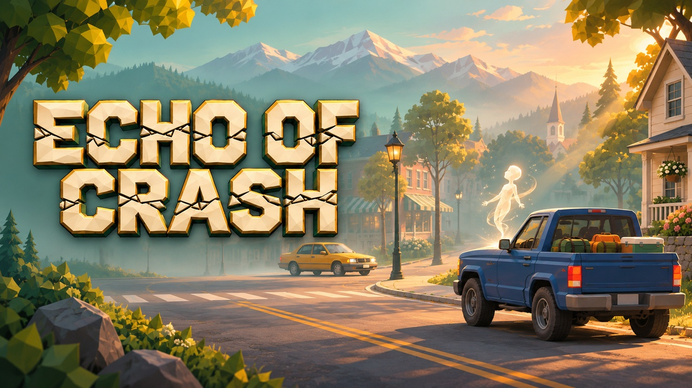
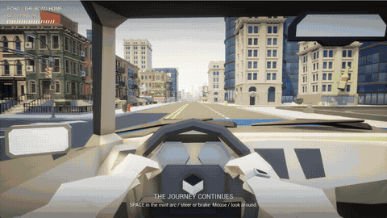
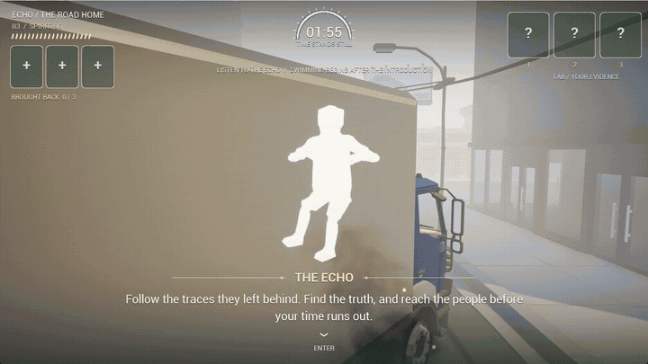
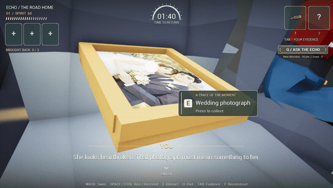
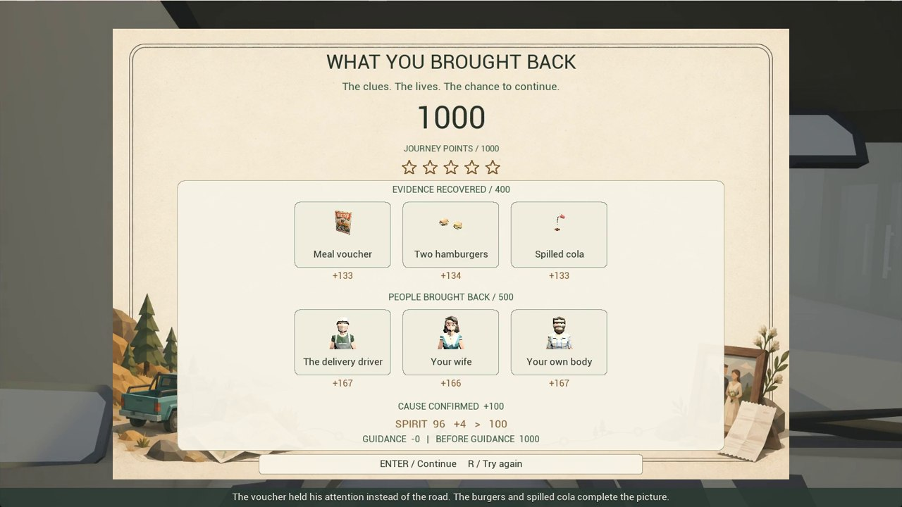
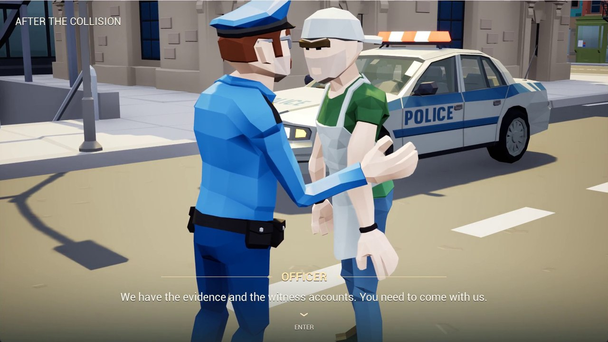

# Echo of Crash

An ordinary drive with your wife can end in three very different collisions. If you miss the moment to avoid one, you wake as a spirit inside the wreck. You have just enough time to ask what happened, or to bring someone back. Doing both takes planning.

**Game design & programming by Yibo Wang** · Narrative investigation · Windows · Unreal Engine 5.8.2 · v0.19.1

**[Play free on itch.io](https://hajimi9914.itch.io/echo-of-crash)**　·　**[Watch the design film · 1m 54s](https://www.youtube.com/watch?v=B0FBTVE2i0M)**　·　**[Read the selected design portfolio · 8 pages](portfolio/Selected.pdf?raw=true)**

## One road, two kinds of attention

From the driver's seat, the next few seconds belong to the road. Watch the other vehicle and press **Space** as the indicator crosses the marked arc. The maneuver depends on the junction. You can swerve past an oncoming sedan, but a truck needs room to finish its turn. After a successful maneuver, the drive continues along the same road.

| From the cockpit | Inside the frozen moment |
| --- | --- |
|  |  |
| **Before impact.** Read the approach from a fixed seat. | **After impact.** Swim through the fog and inspect the same encounter from another angle. |

Once the Echo finishes speaking, the clock starts. On the standard **Journey** setting, a rescue takes a three-second hold and deducts another eight seconds on completion. If you have eleven seconds left beside an injured person, you know exactly what saving them might cost. A requested hint can point you toward a clue, but a newly revealed target costs points.

## A clue has a place

The wedding photograph can be lifted from the seat, opened in the journal, turned over and magnified. Its placement beside the occupant is already part of the story. Only a complete set of evidence gives you a supported choice about the cause of a collision.

## What follows you home

| The case record | Back in the waking world |
| --- | --- |
|  |  |
| The sheet accounts separately for evidence, lives and deduction. | Reconstructing the cause and rescuing the responsible occupant can lead to an arrest. |

Across all three encounters, the driver's mood carries forward. It affects how the couple arrives at their destination. If it reaches zero, they turn home.

## Explore the design and source

| Start here | What to look for |
| --- | --- |
| [Three encounters, with overhead views and route diagrams](docs/Encounters.md) | How I used approach direction, vehicle weight and evidence placement to give each junction its own question. Contains case spoilers. |
| [Guided code walkthrough](docs/Code.md) | Follow the Space input into the avoidance branch, a rescue into the countdown, and the white flash into the first spoken line. |
| [Browse the game module](Source/EchoOfCrash) | The C++ source, Blueprint-callable functions and gameplay tests, readable directly on GitHub. |
| [Complete design portfolio · 18 pages](portfolio/Complete.pdf?raw=true) | The longer illustrated case study, including level layouts, narrative, UI and feedback. |

The source snapshot accompanies the Windows release. Running the game from its project files also requires the Unreal maps, Blueprint assets and licensed content packs. The [Windows download](https://hajimi9914.itch.io/echo-of-crash) includes the playable build.

Selected illustrations, title and UI art are AI-assisted. The figures above show game captures apart from the illustrated film cover. Environment, vehicle, animation and sound credits are listed in the [release credits](docs/Game-credits.txt).
