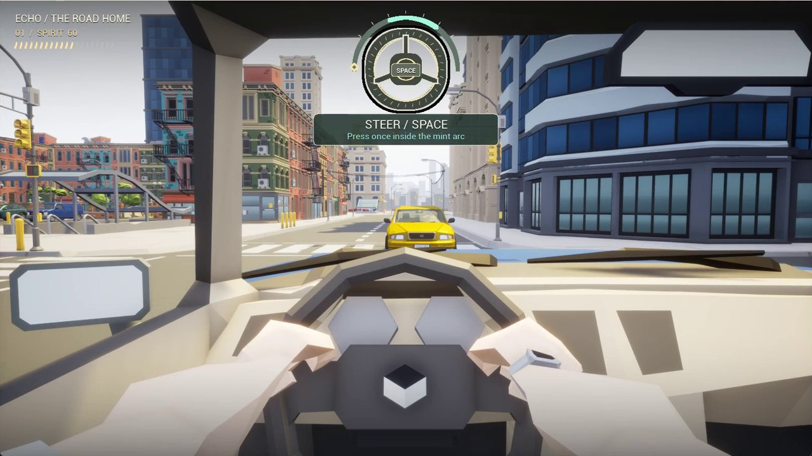
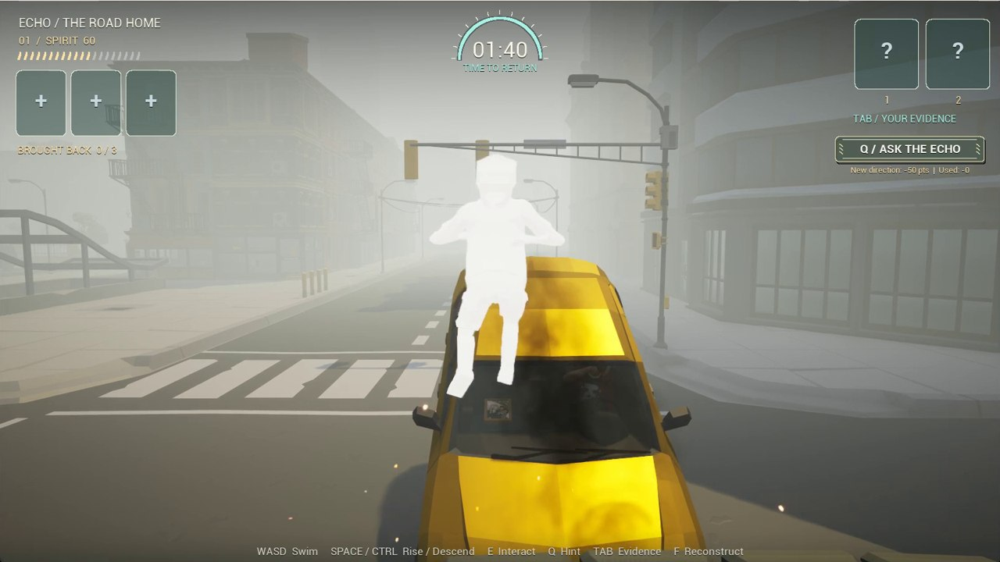

# From player decisions to C++

[Project overview](../README.md) · [Level layouts](Encounters.md) · [All source files](../Source)

## 1. Why the truck needs a different response

The three encounters share one input. Each uses its own timing window and road geometry. Once a press resolves, the player cannot retry during that approach. Success enters a chapter-specific avoidance maneuver. At the narrow truck turn, the pickup brakes to make space. The connecting road carries the player onward after either avoidance or investigation.

| Follow the input | Read the implementation |
| --- | --- |
| The wheel presents a moving marker. The campaign compares its normalized position against the chapter's target arc. | [ResolveQTE](../Source/EchoOfCrash/Private/EchoCampaign.cpp#L146) |
| The original Car Blueprint and the campaign share the same hit predicate. Its Blueprint-callable inputs preserve inclusive or exclusive window edges. | [Blueprint function declaration](../Source/EchoOfCrash/Public/EchoGameplayLibrary.h) · [IsQTEHit](../Source/EchoOfCrash/Private/EchoGameplayLibrary.cpp#L3) · [Boundary tests](../Source/EchoOfCrash/Private/Tests/EchoGameplayTests.cpp) |
| The pickup and opposing vehicle keep moving through the maneuver. The next approach uses the same city road. | [TickAvoidance](../Source/EchoOfCrash/Private/EchoJourney.cpp#L103) · [ContinueRoad](../Source/EchoOfCrash/Private/EchoContinuousRoad.cpp#L58) |

## 2. One clock pays for two kinds of work

Evidence requires contact with the item. A rescue requires contact with the person for three seconds. The additional rescue cost is applied once, on completion. This makes it possible to abandon a hold and reconsider. The final chapter grants fifteen extra seconds for the truck cabin search.

| Preset | Investigation | Cost after a completed hold | First idle hint |
| --- | ---: | ---: | ---: |
| Story | 120 s | 5 s | 18 s |
| Journey | 100 s | 8 s | 22 s |
| Tension | 80 s | 12 s | 30 s |

A requested hint reveals one direction at a time. Each newly revealed target deducts 50 points, up to 250. When the player reconstructs the collision, missing evidence prevents a scored guess. A complete case can earn up to 400 points for evidence, 500 for rescues and 100 for a correct deduction, before hint deductions. Mood uses the underlying case result, so asking for guidance affects the displayed score without directly lowering mood.

[Reach and paid hints](../Source/EchoOfCrash/Private/EchoInvestigation.cpp#L11) · [Collection, rescue and deduction](../Source/EchoOfCrash/Private/EchoCampaign.cpp#L169) · [Scoring, difficulty and endings](../Source/EchoOfCrash/Public/EchoJourneyRules.h)

## 3. Let the first line be heard

The impact briefly whites out the picture. The sound of the collision can decay across that transition. The first awakening line waits for the picture to recover. Movement and the investigation clock wait for the introductory conversation, so listening never spends the player's search time.

[Impact](../Source/EchoOfCrash/Private/EchoJourney.cpp#L96) · [Awakening setup](../Source/EchoOfCrash/Private/EchoCampaign.cpp#L154) · [Soundscape](../Source/EchoOfCrash/Private/EchoSoundscape.cpp) · [Dialogue](../Source/EchoOfCrash/Private/EchoDialogue.cpp)
