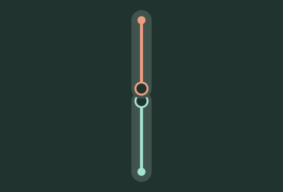
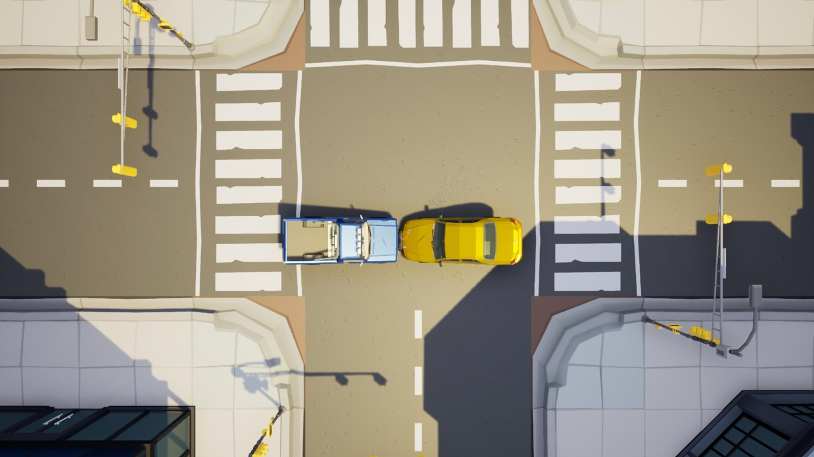
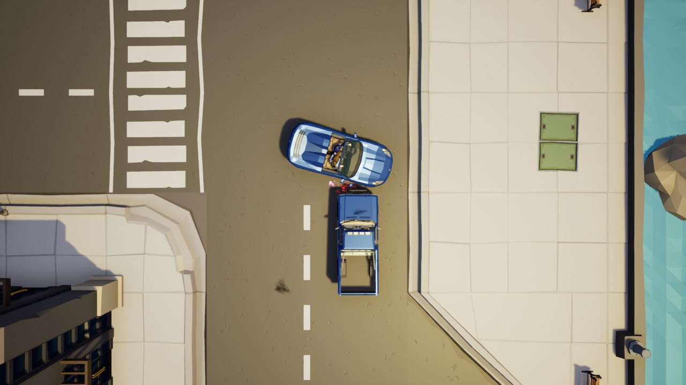
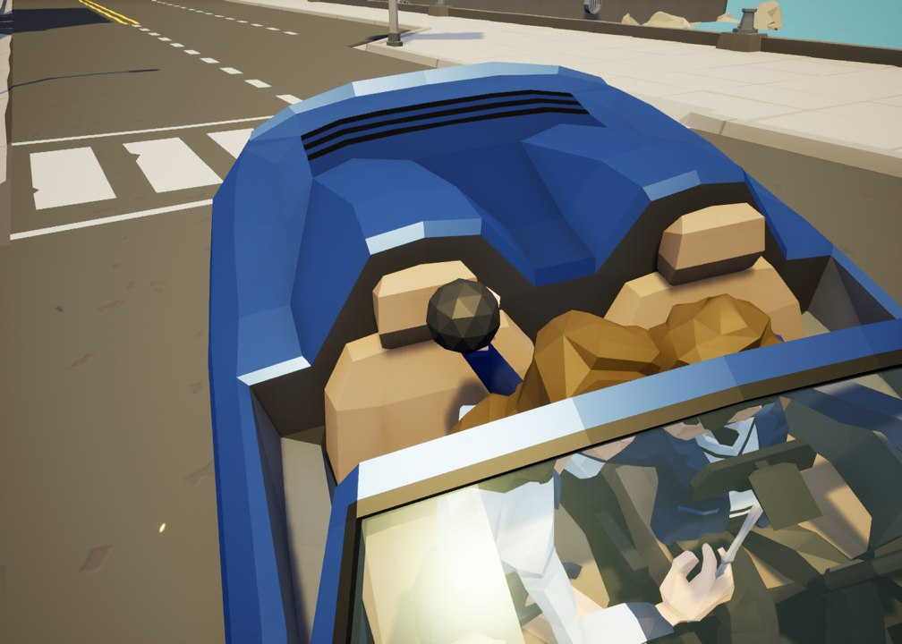
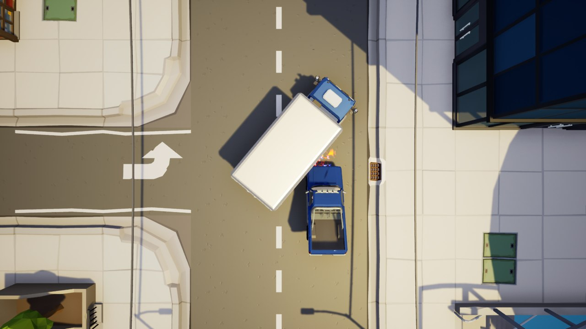
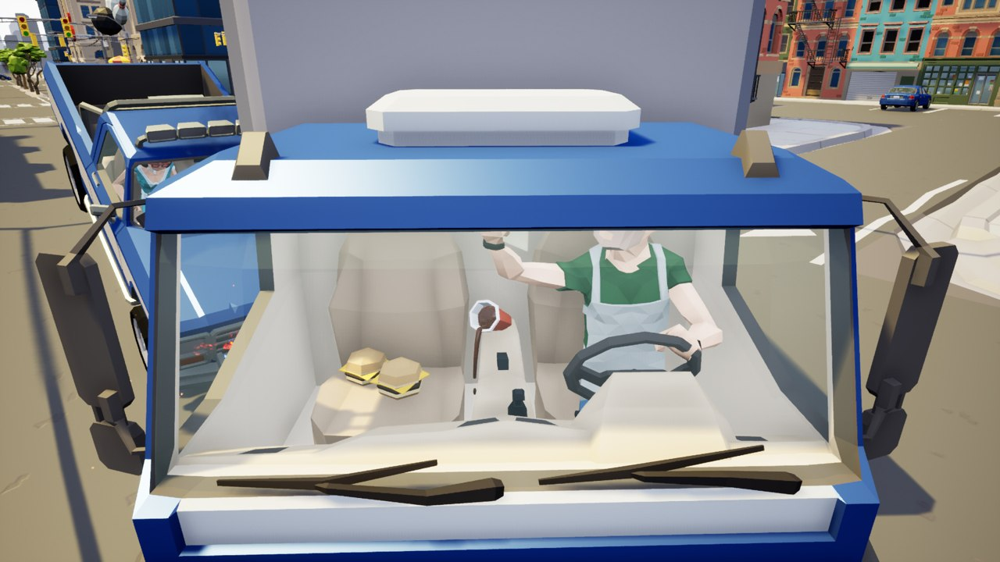
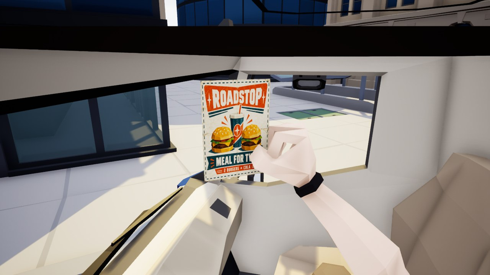

# Three encounters on one road

[Return to the project](../README.md) · **Case spoilers below**

I used a different traffic problem for each chapter, then froze the cars in the same positions the player had just seen from the pickup. The overheads below are analytical views of the actual scenes. The adjacent diagrams trace each approach to contact.

## 01 · An oncoming sedan

| Approach paths | Frozen contact |
| --- | --- |
|  |  |

The sedan enters the pickup's lane head-on. That gives the player a readable threat for their first timing prompt. After a collision, both vehicles lift. The alcohol bottle and the framed wedding photograph ask different questions about the same driver. The bottle is evidence of drinking. The picture beside her connects the collision to her grief.

## 02 · A wide turn at the waterfront

| Approach paths | Frozen contact |
| --- | --- |
|  |  |

The sports car crosses the pickup's path in a wide turn. The pickup meets its right front side. The lighter car tips toward the point of contact while the pickup stays level. The two seated occupants still hold the round stone and the knife. To understand the threat inside the car, the player needs to look at both people's hands.

## 03 · Give the truck space

| Approach paths | Frozen contact |
| --- | --- |
|  |  |

A narrow corner changes the successful response. Brake and the truck has room to turn through. If contact occurs, the truck stays level and the pickup lifts. The cabin preserves the moment of distraction in three evidence entries.

| Where to look | What it tells the player |
| --- | --- |
|  | Two burgers occupy the passenger seat. Beside the controls, cola pours over the cup rim and hangs in the air. |
|  | The driver was reading the voucher while driving. The spill marks the instant of impact. |

Every difficulty keeps the same clues. Story, Journey and Tension instead change the investigation clock, rescue cost and when guidance arrives. For the numbers and the rules behind the case verdict, [read the implementation walkthrough](Code.md).
