# Echo of Crash | Complete design portfolio

Yibo Wang · Game, level and narrative design · 18 pages

Follow the weekend drive from the first design sketches to the three playable collisions. Jump to an area below, or scroll through the pages in their original order. The encounter pages reveal the evidence and outcomes. Select any page image to enlarge it.

[Return to the project](../README.md) · [Selected portfolio · 8 pages](Selected.pdf?raw=true) · [Download the complete PDF](Complete.pdf?raw=true) · [Watch the film](https://www.youtube.com/watch?v=B0FBTVE2i0M)

| Read by topic | Pages |
| --- | ---: |
| [Design foundations](#design-foundations) | 01–05 |
| [Road and encounter design](#road-and-encounter-design) | 06–09 |
| [Investigation and guidance](#investigation-and-guidance) | 10–12 |
| [Consequences and presentation](#consequences-and-presentation) | 13–16 |
| [Iteration and reflection](#iteration-and-reflection) | 17–18 |

## Design foundations

**01 · Echo of Crash / Game Overview**

[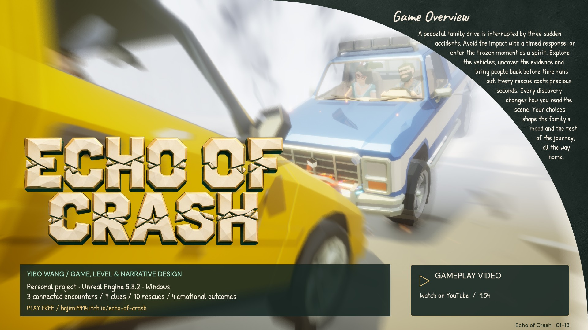](pages/page-01.jpg?raw=true)

**02 · Inspiration, research and references**

[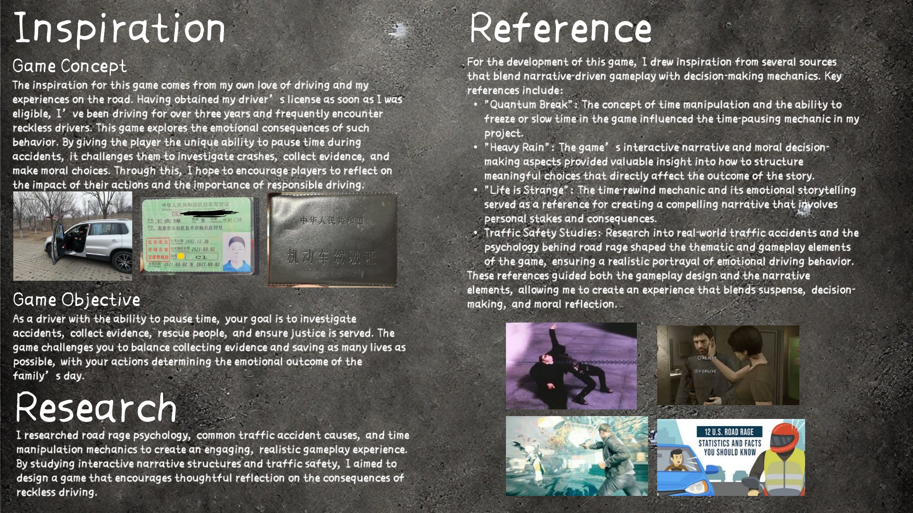](pages/page-02.jpg?raw=true)

**03 · A weekend interrupted. A moment to act.**

[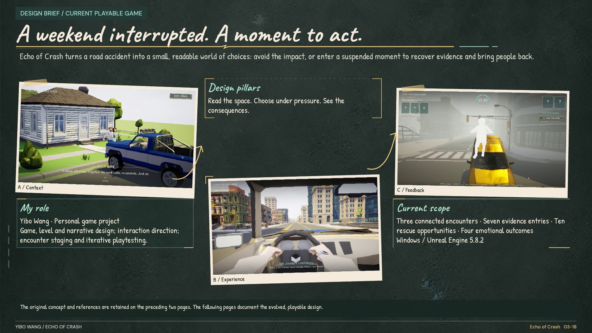](pages/page-03.jpg?raw=true)

**04 · Safety is a success, too.**

[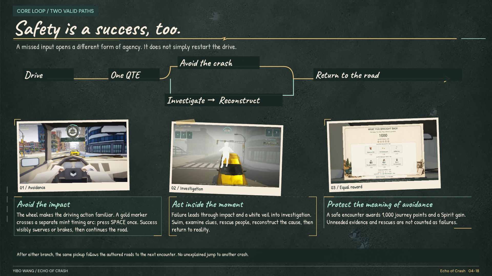](pages/page-04.jpg?raw=true)

**05 · A rescue is a commitment.**

[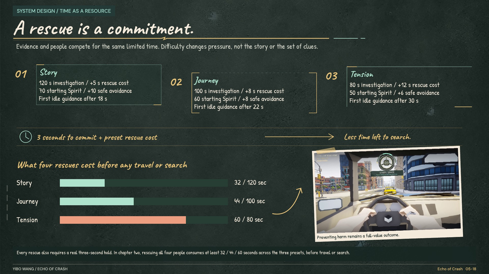](pages/page-05.jpg?raw=true)

## Road and encounter design

**06 · Three incidents. Three spatial questions.**

[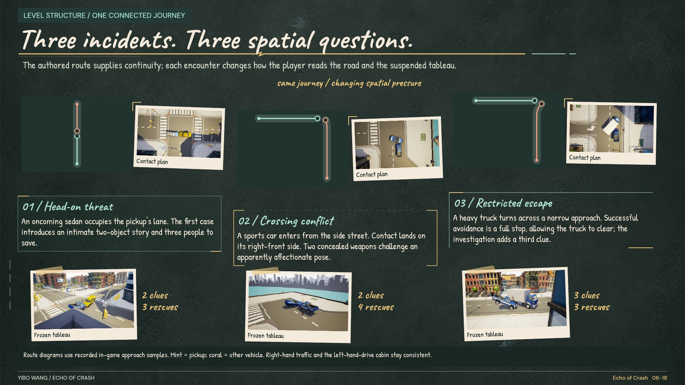](pages/page-06.jpg?raw=true)

**07 · Teach observation before judgment.**

[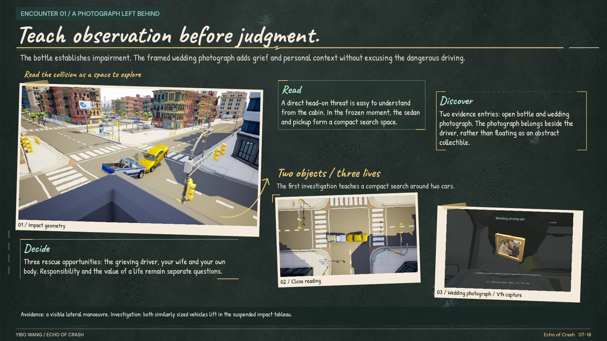](pages/page-07.jpg?raw=true)

**08 · Make the first reading incomplete.**

[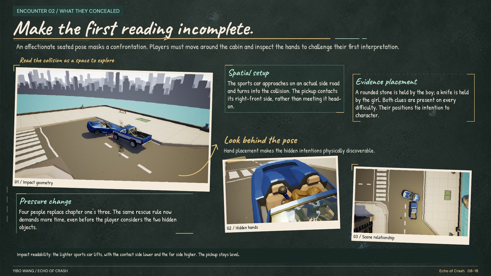](pages/page-08.jpg?raw=true)

**09 · A glance away becomes a chain of evidence.**

[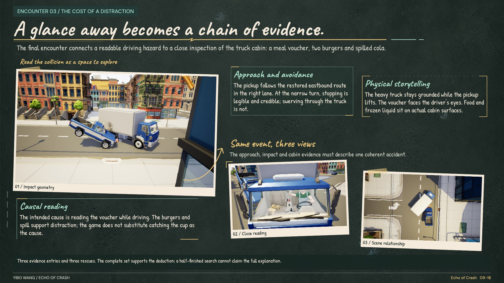](pages/page-09.jpg?raw=true)

## Investigation and guidance

**10 · Change the scale, not the sense of place.**

[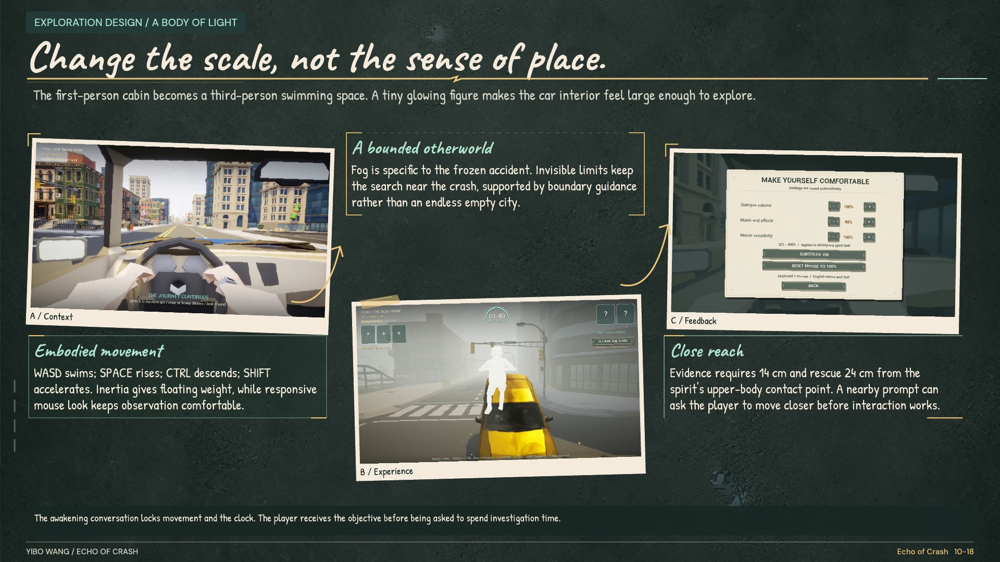](pages/page-10.jpg?raw=true)

**11 · Collecting is only the first reading.**

[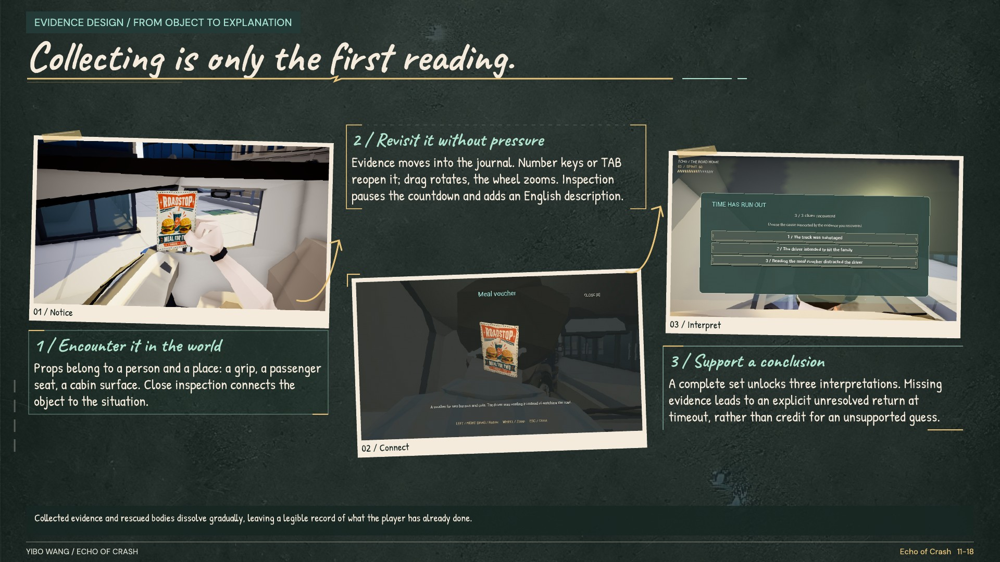](pages/page-11.jpg?raw=true)

**12 · Let the player notice first.**

[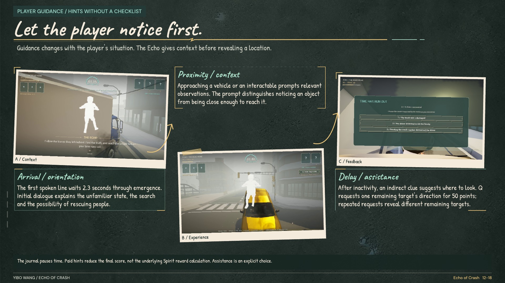](pages/page-12.jpg?raw=true)

## Consequences and presentation

**13 · Carry the day forward.**

[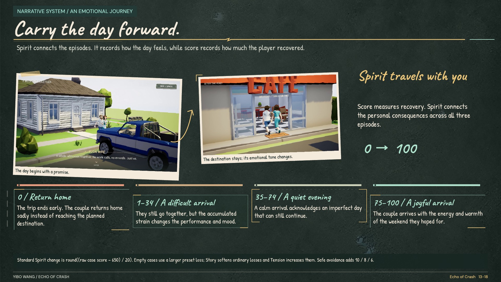](pages/page-13.jpg?raw=true)

**14 · Resolve the case in layers.**

[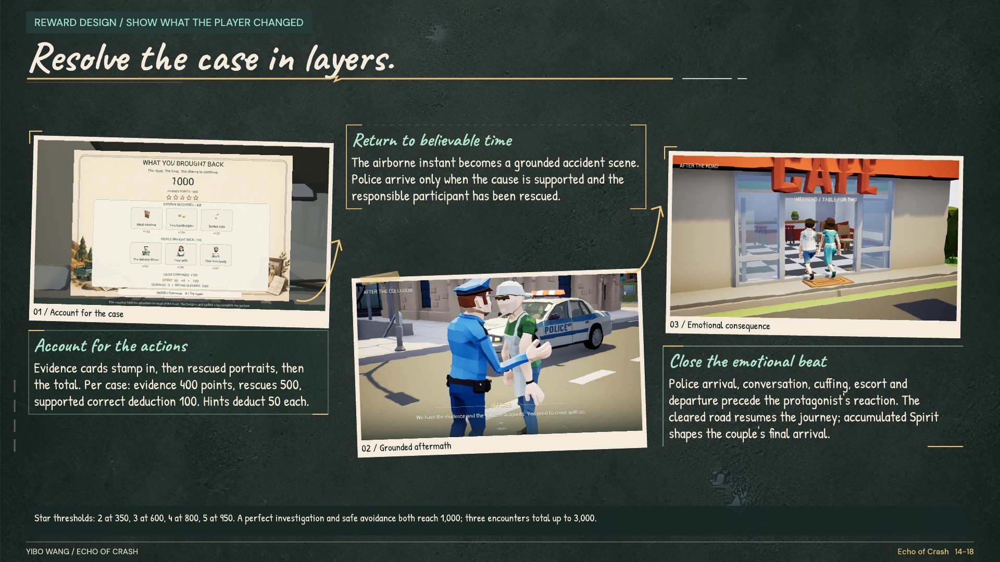](pages/page-14.jpg?raw=true)

**15 · Put the next action in the right place.**

[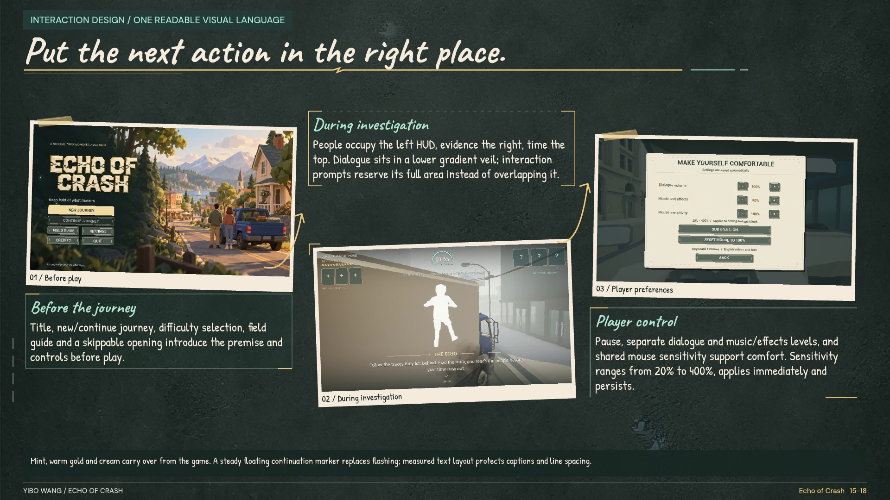](pages/page-15.jpg?raw=true)

**16 · Make the state change audible.**

[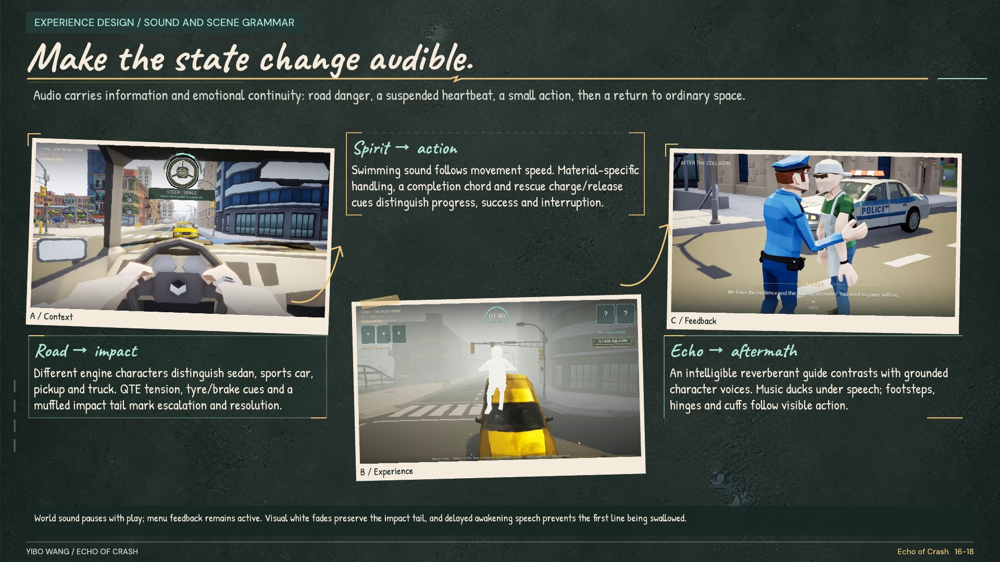](pages/page-16.jpg?raw=true)

## Iteration and reflection

**17 · The strongest changes came from friction.**

[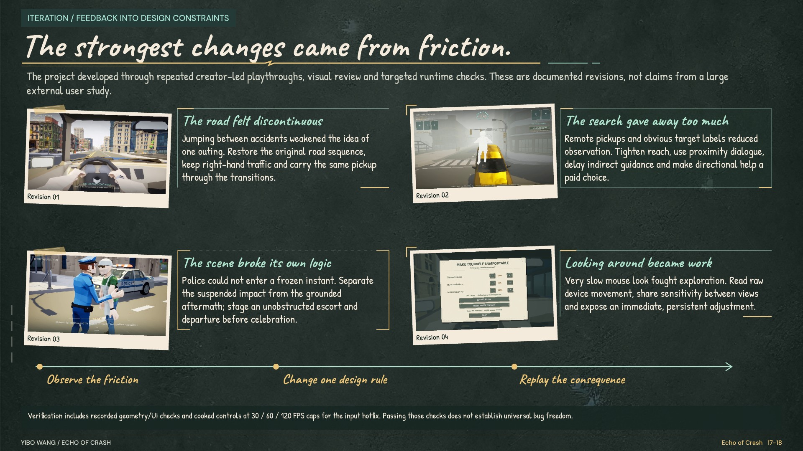](pages/page-17.jpg?raw=true)

**18 · A case study that can be played.**

[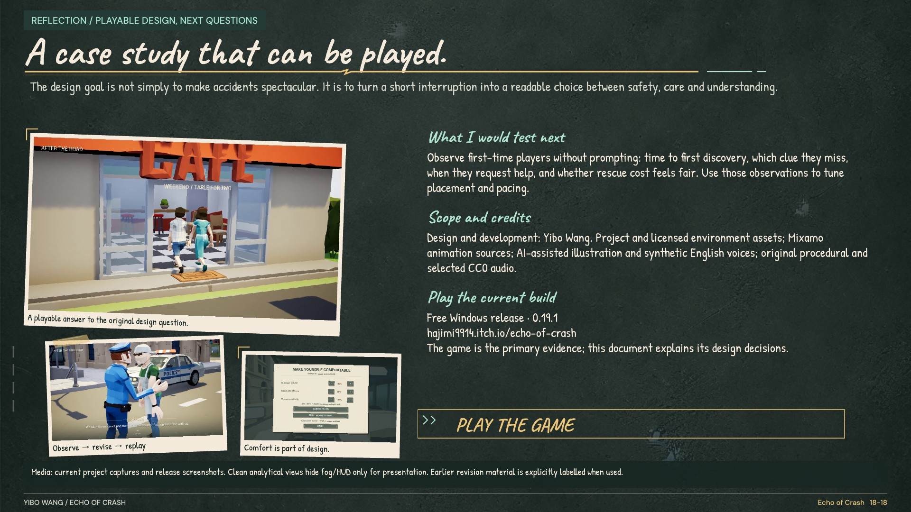](pages/page-18.jpg?raw=true)

[Return to the project](../README.md) · [Download the complete PDF](Complete.pdf?raw=true)
